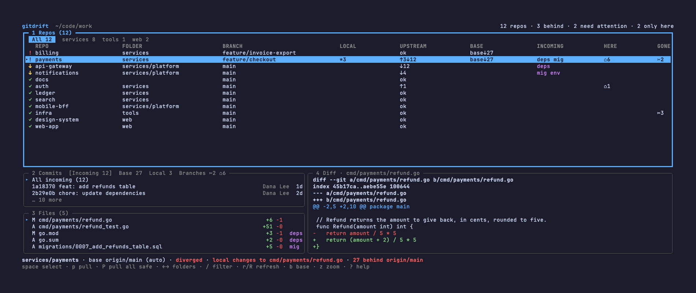
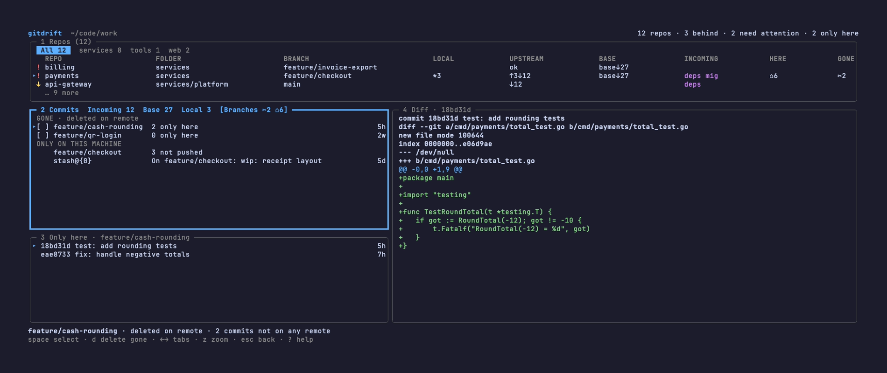
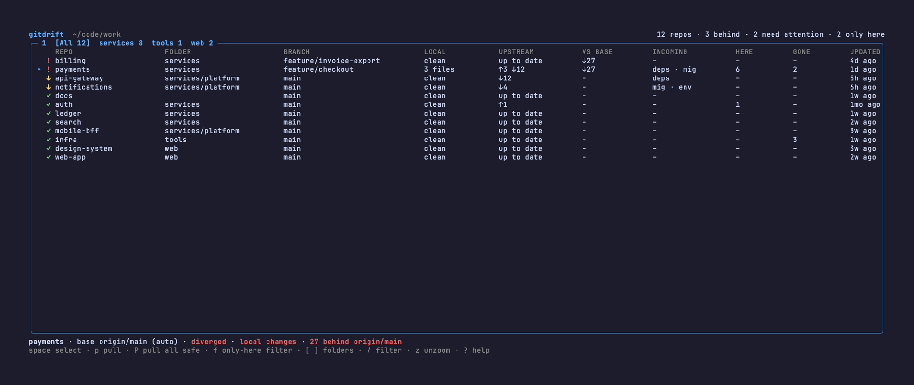

# gitdrift

A terminal dashboard for drift across many git repositories.

[](https://github.com/epicentre/gitdrift/actions/workflows/test.yml)
[](https://pkg.go.dev/github.com/epicentre/gitdrift)
[](LICENSE)


## What it is, and what it is not

gitdrift (`gdrift`) was built for the drift problem: you keep a folder full of
repositories, and over time they fall out of step with their remotes. It
answers five questions at a glance:

- Which repositories are behind their upstream?
- Which feature branches fell behind their base branch?
- What would a pull bring in?
- What work exists only on this machine?
- Which local branches were deleted on the remote?

gitdrift is not a git UI. It has no commit, push, checkout, stash, reset or
rebase. The only things it ever writes are listed under [Safety](#safety).

## Install

Requirements: git 2.30 or newer, macOS or Linux.

```
go install github.com/epicentre/gitdrift/cmd/gdrift@latest
```

Release binaries for macOS and Linux (amd64 and arm64) are attached to each
GitHub release, together with `checksums.txt` and build provenance
attestations.

To build from a checkout:

```
make install     # go install with version information
make build       # writes bin/gdrift
```

## Usage

```
gdrift [flags] [dir]
```

`dir` defaults to the current directory. gdrift looks at `dir` itself (when it
is a repository) and searches the directories below it, up to five levels deep
by default, so a workspace such as `projects/services/billing-api` is found as
well as a flat one.

- The search goes level by level, each level in name order. Setting `--depth N`
  changes the number of levels; `dir`'s direct children are level 1, and a
  value below 1 is refused.
- A directory with a `.git` entry is a repository: it is listed and never
  searched inside (except `dir` itself, whose subdirectories are still
  searched), so a repository nested in another repository below `dir` is not
  shown.
  Linked worktrees have a `.git` entry too and get their own rows at any level.
- A directory whose `.git` entry git does not open as a work tree (no work
  tree, a broken repository, or one git refuses, for example for dubious
  ownership) is not listed and is searched like any other directory. This
  finds the worktrees of a bare clone kept beside them: with `proj/.git` a
  file that points at `proj/.bare`, the worktrees `proj/main` and
  `proj/feature` are listed (`.bare` is hidden and not searched).
- Directories that are not repositories and are hidden (a name starting with
  `.`), `node_modules` or `vendor` are not searched. A repository with one of
  these names is still listed.
- Symlinks are followed and each real directory is searched once, so a link
  loop ends and a repository reached through several routes is shown once, with
  the folder of the shallowest route, then the first in name order.
  Directories gdrift cannot read are skipped; an unreadable `dir` is an error.
- Below `dir`, git runs only in directories that have a `.git` entry, so
  searching a big tree starts few processes. Starting gdrift in your home
  directory still walks it down to the depth limit, which can make macOS ask
  for access to Documents, Desktop or Downloads: run it in a projects folder,
  or lower `--depth`.

| Flag           | Meaning                                                 |
| -------------- | ------------------------------------------------------- |
| `--depth N`    | search up to N directory levels below `dir` (default 5) |
| `--version`    | print version information and exit                      |
| `-h`, `--help` | print usage and exit                                    |

Every repository is fetched when gdrift starts (`r` and `R` fetch again), up to
eight at a time, with a 60 second limit per remote. git never prompts in the
terminal, so a remote that needs a password or passphrase fails (a configured
askpass helper can still run).

| Exit code | Meaning                                                      |
| --------- | ------------------------------------------------------------ |
| 0         | normal exit, or `--version` / `--help`                       |
| 1         | error: not a directory, no repositories found, git too old, ... |
| 2         | usage error: unknown flag, `--depth` below 1 or more than one directory |
| 130       | ended by SIGINT, SIGTERM or SIGHUP                           |

### Reading a row

A header line above the Repos rows names the columns: REPO, FOLDER, BRANCH,
LOCAL, UPSTREAM, BASE, INCOMING, HERE and GONE. A column that has no value in
any row, or that does not fit a narrow pane, is left out together with its
title, and a collapsed pane shows no header. The zoomed table (`z`) shows every
column when it fits; in a narrow pane it cuts the branch and the name first,
then drops columns from the right, and FOLDER is never cut.

FOLDER shows where a repository sits below the folder you started in, such as
`services/platform`; a repository directly in that folder has an empty cell.
When every repository is directly in the folder there is no FOLDER column and
no folder tabs, and the pane looks as it always did. Within a status group the
rows are sorted by folder, then name, so the repositories of a folder stay
together. A folder too wide for its column is cut from the left at a `/`
(`…/platform`), and when the row is too narrow FOLDER is the first column to
shrink and the fifth to be dropped, after GONE, HERE, INCOMING and BASE. The
status line, the dialogs and the notices name a repository in a folder by its
path, such as `services/api`, so that repositories with the same name in
different folders stay apart.

In the Repos pane each repository has a status marker, the checked-out branch
and a few tokens:

| Marker | Meaning                                                              |
| ------ | -------------------------------------------------------------------- |
| `!`    | needs attention: detached HEAD, operation in progress, fetch failed, no upstream, upstream gone, diverged, local changes while behind, the configured base is missing, behind the base, or an inspection error |
| `↓`    | behind its upstream                                                  |
| `✓`    | up to date                                                           |
| `●`    | selected for pull (after the marker)                                 |

| Token    | Meaning                                                              |
| -------- | -------------------------------------------------------------------- |
| `*N`     | N files with uncommitted changes (modified, staged or untracked)     |
| `↓N`, `↑N`, `↑a↓b` | behind, ahead, or diverged from the upstream; `ok` when level |
| `base↓N` | the branch lacks N commits of its base branch                        |
| `base?`  | the configured base branch does not exist                            |
| badge    | a label from the files a pull would bring in (`deps`, `mig`, `env`, ...) |
| `⌂N`     | N commits and stashes that exist only on this machine                |
| `✂N`     | N local branches whose remote branch is gone                         |

`no remote`, `no upstream` and `gone` replace the upstream token when they
apply; for a repository without any remote, `no remote` also stands in for
`⌂N` (all of its work is only here), and the zoom table's HERE column says
`no remote`. A row that is busy shows `fetching…` or `pulling…`, and a pull
result or refusal reason takes the place of the tokens. When a pull brings
the repository under the cursor up to date, its row moves down to the
up-to-date rows and the cursor stays where it was, on the repository that
moved up into its place, ready for the next pull.

The zoom table (`z`) spells the same information out in columns: REPO, FOLDER
(only when a row has one, and never shortened), BRANCH, LOCAL, UPSTREAM,
VS BASE, INCOMING, HERE, GONE and UPDATED.

The Commits pane shows the tabs **Incoming** (what a pull would bring), **Base**
(what the base branch has that this branch lacks), **Local** (uncommitted
changes) and **Branches** (gone branches, branches with local only work, and
stashes). Choose a commit to see its files and its diff in panes 3 and 4.
Each commit shows its short id, subject, author (as the repository's
`.mailmap` names them) and age; on a narrow pane the author is shortened
first and then left out, and `z` shows it in full.

### Folder tabs and the filter

When repositories sit in folders, the first line of the Repos pane holds tabs:
**All**, then one tab for each top-level folder, with the number of
repositories in it; the active tab is drawn as a filled box. A
repository directly in the folder you started in shows only in All. In a folder
tab the FOLDER column shows the path below that tab. Press `←` and `→` (or
`h` and `l`, or `[` and `]`) in the Repos pane to move between the tabs.

`/` starts a filter in the Repos pane: type part of a repository's name or
folder (case is ignored) and the pane shows only the matching rows within the
current tab. While you type, every key with text is typed, `q` and digits
included, and a paste adds its first line; `enter` keeps the filter and `esc`
clears it. While no notice is showing, a kept filter starts the status line,
followed by the repository under the cursor, and `esc` in the Repos pane clears
it. A tab with rows hidden by the filter or by `f` shows `shown/total` as its
count. `p`, `P`, `r` and `R` act only on the repositories on screen, and a
selection that a tab switch, the filter or `f` hides is dropped, with a notice.
`R` refreshes the whole group of each repository shown, so a linked worktree
that is hidden is refreshed along with a shown one of the same repository.

The terminal must be at least 60 columns by 15 rows. Below that gdrift shows a
notice, and dialogs cannot be confirmed until the window is large enough to show
them.

## Keys

| Key                  | Action                                                   |
| -------------------- | -------------------------------------------------------- |
| `↑` `k` / `↓` `j`    | move up / down                                           |
| `pgup` / `pgdown`    | page up / down                                           |
| `g` `home` / `G` `end` | go to top / bottom                                     |
| `tab` / `shift+tab`  | next / previous pane                                     |
| `1` - `4`            | focus a pane                                             |
| `enter`              | open in the next pane                                    |
| `esc`                | back, leave zoom or clear filter                         |
| `←` `h` `[` / `→` `l` `]` | previous / next tab of the focused pane: folder tabs in Repos (when there are folders), Commits tabs elsewhere |
| `/`                  | filter the repositories by name or folder (Repos pane)   |
| `z`                  | zoom the focused pane                                    |
| `space`              | select for pull (Repos pane) or select a gone branch (Branches tab) |
| `p`                  | pull the selected repositories, or the current one       |
| `P`                  | pull every repository on screen that is safe to pull     |
| `r`                  | fetch and refresh the current repository                 |
| `R`                  | fetch and refresh the repositories on screen             |
| `b`                  | choose the base branch of the current repository         |
| `d`                  | delete the selected gone branches, or the one under the cursor (Branches tab) |
| `f`                  | only-here filter: show only repositories with work that exists only here |
| `?`                  | help                                                     |
| `q`, `ctrl+c`        | quit                                                     |

Dialogs show their own keys in the footer (`y` to confirm, `n` or `esc` to
cancel). `ctrl+c` quits even while a dialog is open.

## Features

- Four panes: **1 Repos** across the top, and below it **2 Commits** (tabs
  Incoming, Base, Local, Branches) over **3 Files** (or **Only here** on the
  Branches tab), beside **4 Diff**. The focused pane has a thick border and
  gets most of the room. `z` zooms the Repos pane into a table with one
  column per question.
- Safe, confirmed pull: fast-forward only, one repository or all safe ones,
  after a dialog that names the exact commit you will get.
- Nested workspaces: repositories are found several levels down, with a FOLDER
  column, folder tabs and a `/` filter.
- Base branch per repository, per machine or detected automatically, so you see
  how far a feature branch fell behind (`base↓N`).
- Post-pull badges such as `deps`, `mig` and `env`, so you know to run an
  install or a migration after pulling. You can add your own.
- "Only on this machine": commits and stashes that no remote has, with a filter
  (`f`) that hides repositories without any.
- Gone branch cleanup: local branches whose remote branch was deleted, with
  every pre-check run before anything is removed and a restore command printed
  afterwards.

## Screenshots



The main panes: repositories with their folders and folder tabs, incoming
commits, files and diff.



The Branches tab: gone branches and work that exists only on this machine.



The zoomed repository table, with the FOLDER column.

## Safety

gitdrift is built not to lose your code: nothing is written without the checks
below, and the one destructive action shows what it removes and asks first.
What it trusts and where its guarantees end is described in the
[security model](docs/security-model.md).
Every git process runs through one allowlist.
Besides read-only commands, exactly these writing commands are allowed:

```
git fetch --prune --no-prune-tags --quiet --end-of-options <remote>
git merge --ff-only --no-autostash --no-overwrite-ignore --end-of-options <sha>
git branch -D --end-of-options <name>
git config --local gitdrift.base <value>
git config --local --unset gitdrift.base
```

Anything else is refused, force-style flags included. gdrift never runs a
shell and never overrides your `GIT_SSH_COMMAND`, credential helper or git
config.

### Pull

A pull is a fast-forward merge of the exact upstream commit shown in the
confirm dialog. It is never `git pull`, so your `pull.*` settings do not
matter, and it never fetches: the fetch happened earlier, and the commit you
confirmed is the commit you get.

Right before the merge gdrift re-reads the repository and skips the pull when
anything changed since you reviewed it: another branch is checked out, HEAD or
the upstream moved, or a blocker appeared (local changes to tracked files,
diverged or ahead of the upstream, detached HEAD, no upstream, upstream gone, an
operation in progress, a fetch of the upstream's remote that failed or has not
run yet, nothing to pull, or a repository that could not be inspected).
`--no-autostash` keeps `merge.autoStash` from creating stashes.

`--no-overwrite-ignore` matters because git otherwise lets a merge overwrite
ignored files. If the incoming commits add a tracked `.env` and you have a local
ignored `.env`, a plain merge would replace your file. With the flag git refuses
and your file stays.

### Fetch

Fetch runs with `--prune --no-prune-tags` and never prompts in the terminal.
`--no-prune-tags` keeps your local tags even when `fetch.pruneTags` is set.
gdrift refuses to fetch a remote that has no url in git config, or whose fetch
refspec writes outside `refs/remotes/` (a mirror-style `+refs/*:refs/*`, for
example), because pruning would delete local branches or tags. Such a remote
shows a fetch error and blocks pulling any branch that tracks that remote; the
row is marked `!`.

A failed fetch shows as `fetch failed: <remote>`, and the status line of the
repository under the cursor adds why in parentheses: git's own error line (for
example `fatal: Could not read from remote repository.`), or the reason gdrift
refused to fetch.

### Gone branch cleanup

A gone branch is a local branch whose upstream was deleted on the remote. gdrift
uses `git branch -D`, because a squash merge leaves the branch commits outside
the base branch and the safe `-d` would refuse. To make that acceptable:

- The dialog lists each branch with the commits that exist only on this machine
  (up to five per branch, then `+N more`) before it asks.
- Before deleting, gdrift checks in order that the branch still exists, that its
  tip is unchanged since the review, that it is not checked out in any worktree,
  that its upstream is still gone, and that `git ls-remote --exit-code` confirms
  the branch is absent on the remote. Any other result skips the branch. The
  tip and checkout checks run once more right before `git branch -D`.
- The result window prints a restore command for each deleted branch, such as
  `git branch feature/x 3f2a9c1...`, shell-quoted for unusual names. A name
  with characters a terminal would hide or act on (control or invisible
  formatting characters) is written as `"$(printf '\146\151...')"`, so the
  command restores the exact name.
- Keep the restore command. After the deletion the commits are unreachable, and
  git's garbage collection, which git also runs automatically, can remove them.
  Commits made on this machine are often still listed by `git reflog` for a
  while, but git expires those entries (by default once they are 30 days old),
  so do not rely on it.

### Quitting

`q`, `ctrl+c`, closing the terminal and SIGINT or SIGTERM stop fetches and
network checks, but wait for a running merge, branch deletion or base change to
finish. A stopped git first gets SIGTERM, so that it removes its lock files,
and is killed only if it is still running two seconds later.
gdrift prints `waiting for git to finish…` when that takes more than a second.

## Configuration

Two git config keys, both optional:

- `gitdrift.base` sets the base branch a feature branch is measured
  against. Without it, the remote's default branch, then `main`, then
  `master`, is used. In the dashboard, `b` picks a base for one repository.
- `gitdrift.badge` adds badge rules (`<label>=<pattern>`) to the built-in
  `deps`, `mig` and `env` rules.

```
git config --global gitdrift.base develop
git config --global --add gitdrift.badge 'schema=*.sql'
```

The full reference, including precedence, value forms and the built-in
rules, is in [docs/configuration.md](docs/configuration.md).

## How "only on this machine" is counted

The number behind `⌂` is the commits reachable from local branches but from no
remote-tracking ref, plus stashes. Uncommitted changes are not part of it; they
are shown as `*N` and in the Local tab. All worktrees of a repository share the
count.

## Contributing

See [CONTRIBUTING.md](CONTRIBUTING.md) and
[docs/development.md](docs/development.md). How gitdrift is built, and why, is
described in [docs/architecture](docs/architecture/README.md).

More documentation, including
[troubleshooting](docs/troubleshooting.md) and the
[security model](docs/security-model.md), is in [docs](docs/README.md).

## Security

See [SECURITY.md](SECURITY.md).

## License

MIT, see [LICENSE](LICENSE).
