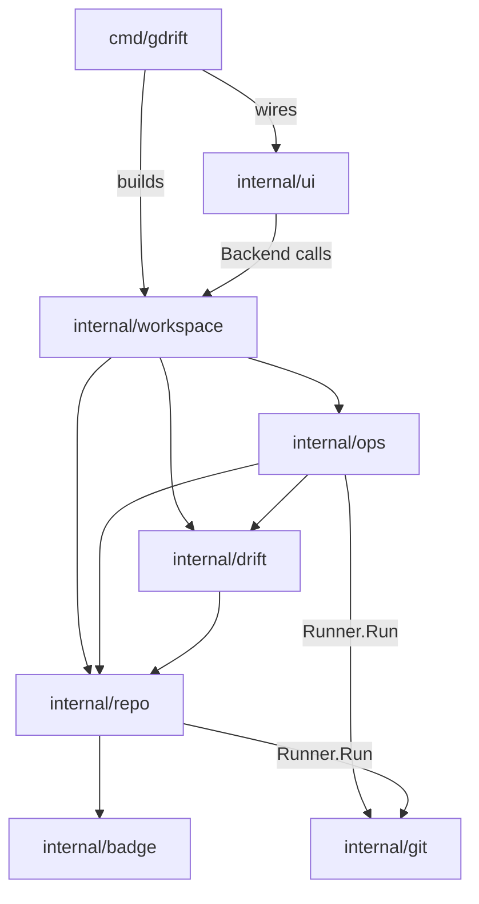
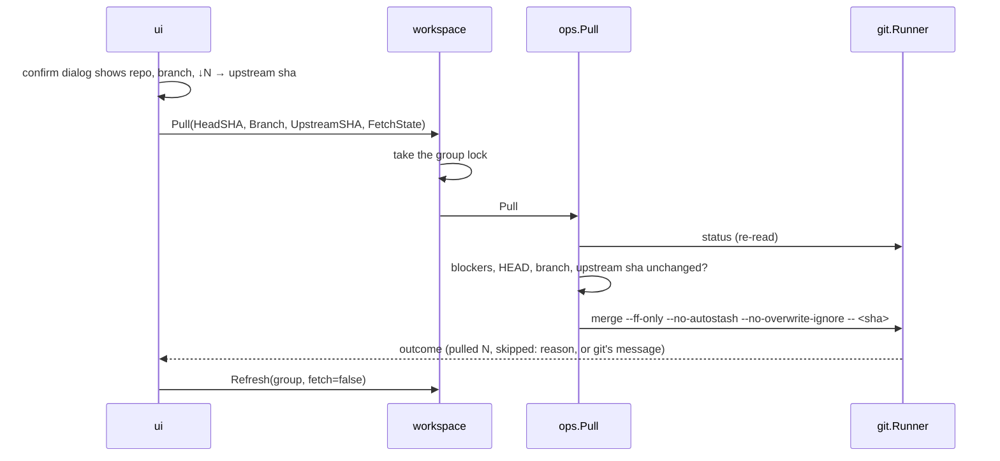

# Architecture

This document explains how gitdrift is put together and why. It is for
contributors; the user-facing behavior is described in the
[README](../../README.md). Individual decisions are recorded as numbered
decision records in this directory (see [Decision records](#decision-records)).

gitdrift (`gdrift`) is a single Go binary with a terminal UI. It inspects
every git repository in one folder, shows how each one drifted from its
remotes, and offers exactly three changes: a confirmed fast-forward pull, a
confirmed deletion of local branches whose remote branch is gone, and
setting the comparison base. It is not a git UI: it never commits, pushes,
checks out, stashes, resets or rebases. The overriding constraint is that it
must never lose user code.

## Code map

The graph shows who calls whom. Imports point the same way and never back
up: the UI also imports `drift`, `repo`, `ops`, `badge` and `git` for their
types and for `git.Message`, but it holds no `git.Runner` and never runs git.
Only `internal/git` starts processes.

| Package | Responsibility |
| --- | --- |
| `cmd/gdrift` | Flags, version, exit codes, signal handling, wiring, the quit sequence. |
| `internal/git` | The only place that starts git: argv allowlist (`Classify`), `Runner` with process-group timeouts and a hardened environment, git version check, `Message` for user-facing error lines. |
| `internal/repo` | Read-only inspection: worktree location, porcelain v2 status, base resolution, gone branches and work that exists only on this machine, commit lists, changed files and diffs. |
| `internal/badge` | Post-pull badge rules (`deps`, `mig`, `env`) and their matching. |
| `internal/drift` | Pure classification without I/O: `Snapshot`, `FetchState`, pull blockers, attention reasons, row categories and sorting. |
| `internal/ops` | The writing operations, each with its pre-checks: guarded fetch, fast-forward pull, gone branch deletion, base setting. |
| `internal/workspace` | Repository discovery, bounded parallel refresh, per-group serialization, `Close`, and the backend the UI calls. |
| `internal/ui` | Bubble Tea v2 model: panes, layout, aligned columns, dialogs, keys, sanitizing of untrusted text. |
| `internal/gittest` | Test helpers: throwaway repositories and bare remotes with isolated git config. Not linked into the binary. |
| `tools/` | A separate module that pins golangci-lint and govulncheck. |

## Data model

- `repo.Location` identifies a worktree: its path, git dir and the common
  git dir shared by linked worktrees.
- `workspace.Group` is all worktrees that share one common git dir. Refs,
  remotes and config are per group, so fetching and writing happen per
  group.
- `drift.Snapshot` is everything known about one worktree at one moment:
  status, base, work only on this machine, badges, badge rules, fetch state
  and any inspection error. The UI renders snapshots; it never derives git
  state itself.
- `drift.FetchState` records, per remote, whether the last requested fetch
  ran and failed. `OK(remote)` is true only after a completed fetch without
  an error for that remote (decision 7).

## Main flows

**Start.** `start` checks for a terminal and git 2.30 or newer, discovers
repositories (the root and the directories below it down to `--depth`,
default 5; see decision 16), groups them, and starts the UI. The UI shows a
FOLDER column and folder tabs when repositories sit in folders
(decision 17). The UI asks the workspace to refresh every group with a fetch.

**Refresh.** For one group: take a concurrency slot (8 by default), take the
group lock, fetch every remote (each refused or failed remote is recorded),
read the group's work once, then read status, base and, when behind, the
incoming files and badges for each member. A failure in one member is stored
in that member's snapshot; the others continue.

**Pull** (decision 3).

**Gone branch deletion** (decision 5): local pre-checks, an `ls-remote`
check against the remote, the local checks again, then `branch -D` and a
printed restore command.

**Quit** (decision 8): cancel the program context, which stops fetches and
network checks, then `Workspace.Close` waits for running writes.

## Invariants

These must stay true; the tests named in each decision record guard them.

1. Only the five argv forms in `internal/git/policy.go` write. Every other
   argv is a read from an allowlist, or it is refused before a process
   starts (decision 1).
2. A pull merges exactly the commit the user confirmed, and only if HEAD,
   the branch and the upstream are as reviewed (decision 3).
3. A branch is deleted only when it is gone on the remote, unchanged since
   review and not checked out anywhere, and the user gets a restore command
   (decision 5).
4. A requested fetch that did not run never reads as current (decision 7).
5. Quitting never kills git in the middle of a write (decision 8).
6. No repository-derived text reaches the terminal unsanitized (decision 12).
7. A write is confirmed only through a dialog that is on screen (decision 13).

## Concurrency

The UI runs every backend call as a Bubble Tea command, so it never blocks.
The workspace bounds parallel refreshes with a semaphore and serializes all
work on one group with a lock that honors context cancellation (decision 6).
Writes take only the group lock. The UI keeps at most one refresh per group
in flight and queues one more. Every git call gets its context from the
program context created in `main`, except the two writes that must finish
once started (decision 8). Goroutine leaks are checked with `goleak` in the
workspace tests.

## Errors and messages

Errors are wrapped with `%w` and keep `*git.CommandError` (argv, exit code,
stdout, stderr) reachable through `errors.As`. For display, `git.Message`
picks git's own line (`fatal:`/`error:`, else the last non-empty stderr
line, plus an indented file list when git prints one) or `timed out`. The UI
sanitizes that line before rendering it.

## Testing

Tests run real git in temporary directories through `internal/gittest`
(decision 14). The UI is tested by driving `Update` directly with a fake
backend, by golden files (`go test ./internal/ui -update`), by a resize
sweep, and by one end-to-end test that pulls in real repositories through
the real workspace. Parsers of git output are fuzzed (`make fuzz`).

## Build and release

`make check` runs formatting, lint, the race-enabled tests, govulncheck and
the English check. Releases are built by GoReleaser on a tag push, with
checksums and build provenance; GitHub Actions are pinned by commit SHA
(decision 15).

## Decision records

Each record states its context, the decision and its consequences. Records
are not rewritten when a decision changes; a new record supersedes the old
one, and the old one's status says so.

| # | Decision | Status |
| --- | --- | --- |
| [1](0001-run-git-through-an-allowlist.md) | Run the git CLI through an argv allowlist | Accepted |
| [2](0002-isolate-git-processes.md) | Isolate git processes and stop them gracefully | Accepted |
| [3](0003-pull-is-a-fast-forward-of-the-reviewed-commit.md) | Pull is a fast-forward of the reviewed commit | Accepted |
| [4](0004-guard-fetch-with-prune.md) | Fetch with prune, guarded against deleting local refs | Accepted |
| [5](0005-delete-gone-branches-after-checks.md) | Delete gone branches with `-D` after pre-checks | Accepted |
| [6](0006-serialize-work-per-repository-group.md) | Serialize work per repository group | Accepted |
| [7](0007-fetch-state-fails-closed.md) | Fetch state fails closed | Accepted |
| [8](0008-quit-waits-for-git-writes.md) | Quitting waits for git writes | Accepted |
| [9](0009-resolve-the-base-branch.md) | Resolve the base branch from repo, global, then auto | Accepted |
| [10](0010-post-pull-badges.md) | Post-pull badges from incoming file names | Accepted |
| [11](0011-pane-layout-and-aligned-columns.md) | One screen of panes with aligned, full-width columns | Accepted (compact drop order superseded by 17, pane layout by 19) |
| [12](0012-sanitize-repository-text.md) | Treat repository text as untrusted | Accepted |
| [13](0013-confirm-only-what-is-on-screen.md) | Confirm only what is on screen | Accepted |
| [14](0014-test-against-real-git.md) | Test against real git with isolated config | Accepted |
| [15](0015-tooling-and-supply-chain.md) | Pin tools in a module and actions by commit SHA | Accepted |
| [16](0016-discover-repositories-recursively.md) | Discover repositories recursively, bounded by a depth | Accepted |
| [17](0017-folders-in-the-repos-pane.md) | Show folders in the Repos pane: column, tabs and a filter | Accepted (tab keys superseded by 18, tab placement by 19) |
| [18](0018-switch-tabs-with-the-arrow-keys.md) | Switch tabs with the arrow keys | Accepted |
| [19](0019-repos-pane-on-top.md) | Put the Repos pane on top at full width | Accepted |
| [20](0020-keep-the-cursor-row-when-a-pull-lands.md) | Keep the cursor's row when a pull lands | Accepted |

### Adding a decision

Copy the structure of an existing record into the next number
(`NNNN-short-title.md`), set `Status: Proposed`, and change it to `Accepted`
when the change lands. A decision that changes what gitdrift may write to a
repository also updates `internal/git/policy.go`, AGENTS.md, CONTRIBUTING.md
and the README's Safety section in the same change.
